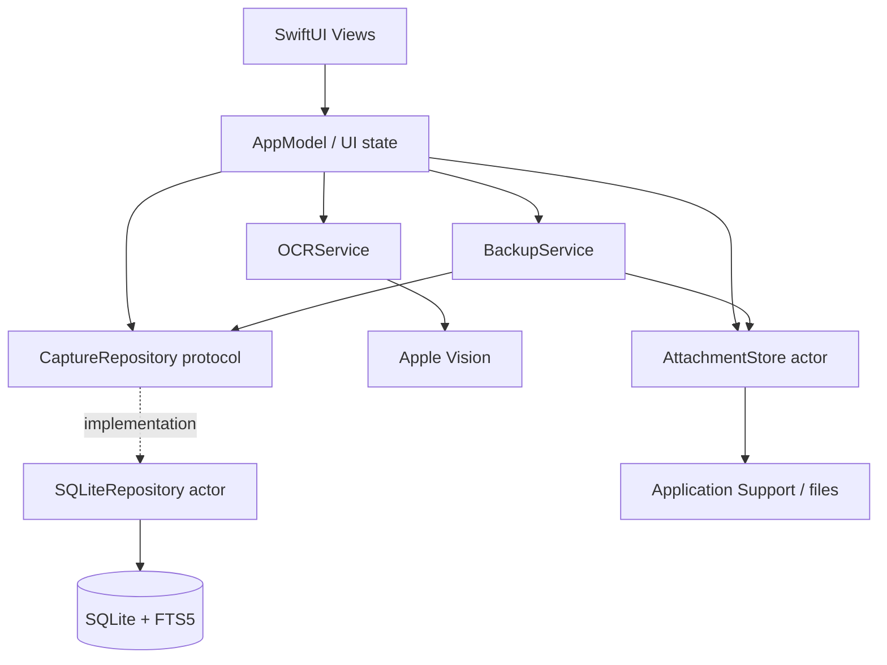

# Architecture — ReFind One v0.2

## Context

Target: native SwiftUI iOS 17+, specifically guest IPA on iOS 27.0.1 in LiveContainer. No JIT, Share Extension, private entitlements, persistent background worker, cloud backend, or third-party libraries. User content local; limits documented.

## Layer boundary

`CaptureItem`, `CaptureKind`, `LinkNormalizer`, and `ReFindError` live in `Domain/` with Foundation only. `AppModel` is main-actor isolated and injectable via `CaptureRepository`. `SQLiteRepository` owns an internal synchronous SQLite connection; actor isolation serializes access. `AttachmentStore` owns generated names, safe extensions, size limits. `BackupService` serializes DTOs to JSON and Base64 attachments. `OCRService` performs Apple Vision work off the main actor. SwiftUI contains presentation, not SQL.

## Data model & invariants

`id` UUID, `kind` string, `title`, `note` (editable), `extractedText` (imported immutable until future re-OCR), `originalURL`, `normalizedURL`, `attachmentFile` (only validated UUID.ext), `tags`, created/updated dates, `isFavorite`. An image/PDF can be saved without OCR output. No foreign file paths are persisted.

The table `captures` is authoritative. FTS is a derived table updated inside the same transaction as `upsert/delete`. `PRAGMA user_version=1`. Query params are bound. FTS `MATCH` terms are conservatively escaped. On SQLite without FTS5, fallback to escaped `LIKE`. `list` returns at most 250 rows in descending creation order; pagination is P1. `allItems` supports backups and must be moved to streaming for very large databases.

## Error semantics

Failed photo OCR -> photo is still saved with empty `extractedText`; no false OCR text is invented. Failed save -> saved attachment is deleted best-effort. Failed file load -> user-visible error. Failed backup parse -> reject invalid archive. Restore is **add-only and not yet atomic across multiple items** (known limitation); existing UUID records are left unchanged. Export is plain JSON; users must store it securely. Guest isolation is weaker than conventional iOS app sandbox isolation.

## Decisions

**ADR-001: SwiftUI + platform SDK, no external dependencies.** Makes sideloading, signing, maintenance, IPA size and security review easier. Native APIs suffice for v0.1. Tradeoff: no universal video decoding and no advanced AI by default.

**ADR-002: SQLite with FTS5 instead of SwiftData/Core Data.** Explicit migrations, predictable file location, portability, reproducible tests under Linux. Tradeoff: manual SQL mapping, backup codec maintenance; covered by unit tests.

**ADR-003: local OCR through Vision.** Avoids subscription, personal-data uploads and mandatory network. Tradeoff: language/device recognition quality varies; test on target iPhone.

**ADR-004: manual share/clipboard ingestion, no iOS extension.** Reliable base functionality inside LiveContainer. Tradeoff: an extra action versus a native Share Extension. Validate Shortcuts support separately.

**ADR-005: JSON v1 export with Base64 attachments.** No dependency and easy verification. Tradeoff: roughly +33% attachment payload overhead, memory spikes, unencrypted. Replace before very large libraries; maintain v1 backward compatibility.

**ADR-006: inject repository, keep actors at IO boundaries.** Allows database tests on Linux and possible in-memory testing. UI is main-actor isolated; no actor nesting inside views.

## Threat model / operational limits

- Assume that another untrusted guest IPA in the same LiveContainer may inspect local guest data. Don't store credentials.
- URL input may be malicious: only http/https, reject embedded credentials, preserve original; no network request during capture.
- Imported files may be malicious or huge: require file type + size check, copy to private generated file, decode through system APIs; trust neither backup filenames nor metadata.
- SQLite queries must be parameterized. FTS search is sanitized; LIKE fallback escapes metacharacters.
- No server telemetry. Do not print capture contents to logs.
- IPA binary must be signed by the toolchain / LiveContainer; signed product cannot be built on Linux in this workspace.

## Quality plan

Unit tests: URL parsing and normalization; CRUD/Favorites/FTS/search injection; full backup round-trip with an attachment; invalid backup/path rejection. Linux Swift 6.2 `swift test`. Device smoke list in README and master prompt. UI screenshots and VoiceOver verification require iPhone simulator/physical device.

**ADR-007: cloud Xcode build for Windows-only maintainers.** iOS production compilation is isolated in manually dispatched GitHub Actions on the `xcode-27` runner. The pipeline creates an unsigned IPA, checks `Payload`/plist/ARM64 binary integrity, then uploads an artifact. GitHub hosts never receive user content or signing credentials. Existing core tests remain runnable on Linux/Windows tooling. Device smoke tests and LiveContainer JIT-less re-signing remain manual release gates.
